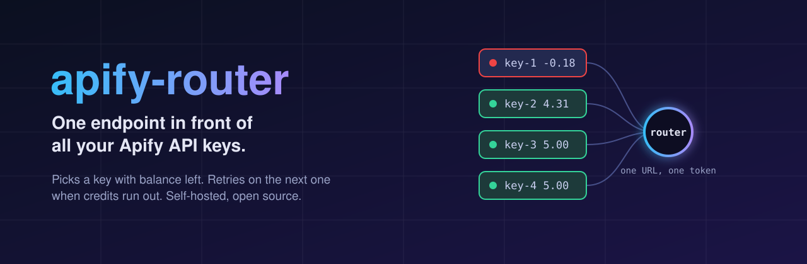
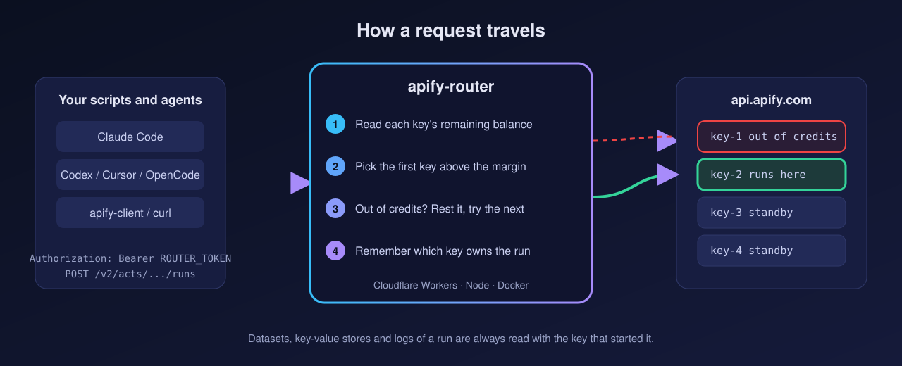
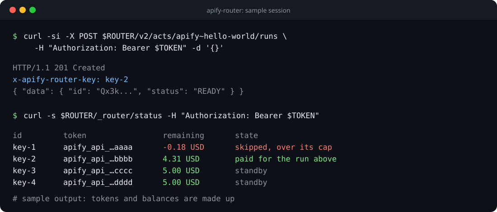

<p align="center">
  
</p>

<p align="center">
  <a href="https://github.com/digosercarlos/apify-router/actions/workflows/ci.yml"></a>
  <a href="LICENSE"></a>
  
  
</p>

# apify-router

> One URL, one token, many Apify accounts.

If you run several Apify accounts you end up juggling their API keys by hand, and a scraper dies the moment one account hits its monthly cap. apify-router sits in front of all of them. Your scripts and coding agents call a single endpoint with a single token. The router checks which account still has credit, starts the run there, and moves to the next account when one runs dry.

It speaks the Apify REST API, so most code only needs a different base URL.

<p align="center">
  <a href="https://deploy.workers.cloudflare.com/?url=https://github.com/digosercarlos/apify-router"></a>
</p>

## Why use it

- One endpoint for scripts, `apify-client`, `curl` and coding agents. Nobody needs to know which key is active.
- Keys are chosen by remaining monthly balance, read live from Apify.
- A key that runs out of credits rests for an hour and the run is retried on the next one.
- Datasets, key-value stores and logs always go back to the key that started the run.
- You host it yourself, on your own Cloudflare account or your own machine. Your keys never leave your infrastructure.
- Ships a script that writes the "use the router" rule into `CLAUDE.md`, `AGENTS.md`, Cursor and Gemini files.

<p align="center">
  
</p>

## What you need

| Requirement | Why | Install |
|---|---|---|
| Node.js 20 or newer | Runs the router and the tests | `brew install node` (macOS), [nvm](https://github.com/nvm-sh/nvm) or [nodejs.org](https://nodejs.org) |
| Two or more Apify API tokens | The keys the router chooses between | [Apify console](https://console.apify.com/settings/integrations), Settings, API & Integrations |
| A Cloudflare account | Only for the Workers deploy. The free plan is enough | [dash.cloudflare.com](https://dash.cloudflare.com/sign-up) |
| Docker | Only if you prefer containers | `brew install --cask docker` (macOS) or [docs.docker.com](https://docs.docker.com/get-docker/) |

Everything else installs with `npm install`. Wrangler, the Cloudflare CLI, runs through `npx` and needs no global install.

## Quick start

Pick one.

### Option A: Cloudflare Workers

```bash
git clone https://github.com/digosercarlos/apify-router.git
cd apify-router
npm install

npx wrangler login
npx wrangler kv namespace create KV          # optional, copy the id into wrangler.toml
npx wrangler secret put APIFY_KEYS           # paste your tokens on one line, separated by commas
npx wrangler secret put ROUTER_TOKEN         # any long random string you invent
npx wrangler deploy
```

Wrangler prints your URL, something like `https://apify-router.<you>.workers.dev`. More detail in [docs/SELF_HOSTING_CLOUDFLARE.md](docs/SELF_HOSTING_CLOUDFLARE.md).

### Option B: Docker

```bash
git clone https://github.com/digosercarlos/apify-router.git
cd apify-router
cp .env.example .env                         # fill APIFY_KEYS and ROUTER_TOKEN
docker compose up -d
```

The router listens on `http://localhost:8787`. More detail in [docs/SELF_HOSTING_DOCKER.md](docs/SELF_HOSTING_DOCKER.md).

### Option C: Node, no container

```bash
git clone https://github.com/digosercarlos/apify-router.git
cd apify-router
npm install
cp .env.example .env                         # fill APIFY_KEYS and ROUTER_TOKEN
set -a; source .env; set +a
npm start
```

Generate a router token with `openssl rand -hex 32`.

## Use it

Swap the base URL for yours and use `ROUTER_TOKEN` wherever an Apify token goes.

```bash
export ROUTER=https://YOUR-ROUTER
export TOKEN=your-router-token

curl -X POST "$ROUTER/v2/acts/apify~hello-world/runs" \
  -H "Authorization: Bearer $TOKEN" \
  -H "Content-Type: application/json" \
  -d '{}'
```

```js
import { ApifyClient } from 'apify-client';
const client = new ApifyClient({ baseUrl: 'https://YOUR-ROUTER', token: process.env.ROUTER_TOKEN });
```

```python
from apify_client import ApifyClient
client = ApifyClient(os.environ["ROUTER_TOKEN"], api_url="https://YOUR-ROUTER")
```

Every response carries `x-apify-router-key`, the label of the key that paid for the call. `GET /_router/status` lists each key with its masked token, remaining balance and whether it is resting.

<p align="center">
  
</p>

## Point your coding agents at it

One command writes a short rule block into the instruction files agents read, so they stop calling `api.apify.com` directly.

```bash
# inside a project: CLAUDE.md, AGENTS.md (Codex, OpenCode, Cursor), GEMINI.md, .cursor/rules
node scripts/install-rules.mjs --url https://YOUR-ROUTER

# for every project on your machine
node scripts/install-rules.mjs --url https://YOUR-ROUTER --global

# preview, limit to some agents, or undo
node scripts/install-rules.mjs --url https://YOUR-ROUTER --dry-run
node scripts/install-rules.mjs --url https://YOUR-ROUTER --only claude,codex
node scripts/install-rules.mjs --remove
```

The block sits between `<!-- apify-router:start -->` and `<!-- apify-router:end -->`. Run the command again and it replaces the block instead of duplicating it. Your own text in those files stays untouched.

Rules are only guidance for the model. To make the router unavoidable, also set `APIFY_API_TOKEN` to the router token and the Apify base URL to the router. See [docs/AGENTS.md](docs/AGENTS.md).

## Settings

| Variable | Default | Meaning |
|---|---|---|
| `APIFY_KEYS` | required | Apify tokens separated by commas (or newlines in a `.env`), or JSON `[{"token","label","limitUsd"}]` |
| `ROUTER_TOKEN` | required | Token clients send to the router |
| `STRATEGY` | `fill` | `fill` uses keys in order until one runs low. `balanced` always takes the key with the most balance |
| `MIN_HEADROOM_USD` | `0.5` | Skip a key whose remaining balance is below this |
| `COOLDOWN_SEC` | `3600` | How long a key rests after Apify says it is out of credits |
| `PORT` | `8787` | Port for the Node and Docker builds |

## Limits

- A run cannot move to another account halfway. It lives where it started. If it dies for lack of credits, start it again and it goes to a key with balance.
- The router does not predict what a run will cost. It keeps a flat margin (`MIN_HEADROOM_USD`).
- A rejected key (401) is returned as is, it does not trigger a retry yet.
- Without a KV namespace, state lives in the process. Routing still works, because balances come from Apify and unknown owners are found by trying each key, but it forgets more often.

## Responsible use

Only add keys from accounts you own. Read Apify's terms before spreading usage across several free accounts. What you do with this tool is on you.

## Development

```bash
npm install
npm test
npm run typecheck
```

Issues and pull requests are welcome. See [CONTRIBUTING.md](CONTRIBUTING.md).

## License

[MIT](LICENSE)
